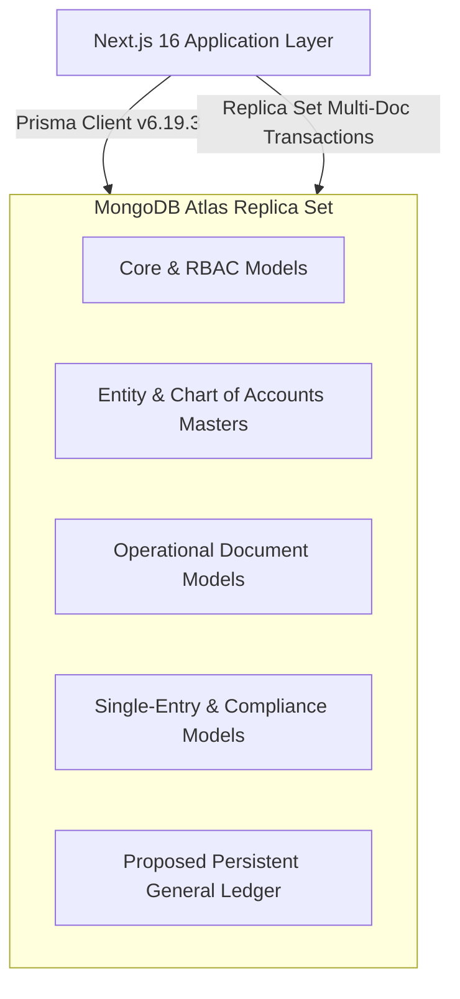

# FINLEDGER ERP — DATABASE ARCHITECTURE & COLLECTION INVENTORY DESIGN

**Organization:** KVJ Analytics (Indian IT & Analytics Services)  
**System:** FinLedger ERP  
**Document Type:** Database Architecture & Collection Inventory  
**Baseline Date:** 21 October 2026  
**Document Status:** DESIGN FROZEN & EVIDENCE-BACKED (PROMPT 3)  

---

## 1. Executive Database Overview

FinLedger operates on **MongoDB Atlas** using **Prisma ORM v6.19.3** as the data modeling and client query layer.



### Datasource & Generator Configuration
From `prisma/schema.prisma`:
```prisma
generator client {
  provider      = "prisma-client-js"
  binaryTargets = ["native", "darwin-arm64"]
}

datasource db {
  provider = "mongodb"
  url      = env("DATABASE_URL")
}
```

### Critical Database Characteristics
1. **Database Provider:** MongoDB Atlas Replica Set (supports distributed ACID transactions via `prisma.$transaction`).
2. **Primary Key Pattern:** All collections use BSON ObjectId mapped via `@id @default(auto()) @map("_id") @db.ObjectId`.
3. **Current Numeric Type:** All monetary fields in existing operational models are stored as BSON `Double` (represented as Prisma `Float`).
4. **Current Accounting Paradigm:** Single-entry operational transaction logging (`FinancialTransaction`), coupled with an on-the-fly, in-memory double-entry accounting engine (`services/accounting-engine.service.ts`).

---

## 2. Complete Model & Collection Inventory (34 Existing Models)

| # | Model / Collection Name | Primary Purpose | Key Fields | Relationships | Monetary Fields (BSON Double / Float) | Current Posting Behavior |
|---|-------------------------|-----------------|------------|---------------|---------------------------------------|--------------------------|
| 1 | `RoleDefinition` | Granular RBAC definitions | `name`, `permissions`, `isSystem` | `User[]` | None | Non-accounting |
| 2 | `User` | User auth, login & roles | `email`, `password`, `role`, `roleDefinitionId` | `RoleDefinition` | None | Non-accounting |
| 3 | `Employee` | Payroll & staff records | `employeeCode`, `name`, `pan`, `salary` | `Expense[]`, `EmployeeAdvance[]`, `RecurringExpense[]` | `salary` | Non-accounting; salary used in payroll wizard |
| 4 | `EmployeeAdvance` | Staff advance disbursements & recovery | `advanceNumber`, `amount`, `repaidAmount`, `balanceAmount`, `status` | `Employee` | `amount`, `repaidAmount`, `balanceAmount` | Tracks advance balances; deducted during payroll |
| 5 | `CompanySettings` | Organization profile & GST details | `businessName`, `GSTIN`, `state`, `stateCode`, `financialYear` | None | None | Non-accounting; config for numbering & headers |
| 6 | `Customer` | Client master records | `legalName`, `tradeName`, `gstin`, `customerType`, `placeOfSupply` | `ProformaInvoice[]`, `TaxInvoice[]` | None | Master entity; sub-ledger dimension |
| 7 | `Product` | Goods & services catalogue | `name`, `hsnSacCode`, `type`, `sellingPrice`, `gstRate` | `ProformaInvoiceItem[]`, `TaxInvoiceItem[]`, `ExpenseItem[]` | `sellingPrice`, `customPrice`, `purchasePrice`, `gstRate`, `cessRate` | Pricing master for line items |
| 8 | `BankAccount` | Corporate bank & cash ledgers | `accountName`, `bankName`, `accountNumber`, `ifsc`, `isPrimary` | `ExpensePayment[]` | None (account details) | Real banking entity; destination for settlements |
| 9 | `ProformaInvoice` | Pre-billing quotes & estimates | `invoiceNumber`, `customerId`, `status`, `subtotal`, `totalAmount` | `Customer`, `ProformaInvoiceItem[]` | `subtotal`, `totalDiscount`, `totalCGST`, `totalSGST`, `totalIGST`, `totalTax`, `tdsAmount`, `grossAmount`, `netAmount`, `totalAmount` | **Strictly non-accounting**. No GL entries generated. |
| 10 | `ProformaInvoiceItem` | Line items for proforma invoices | `productId`, `incomeCategoryId`, `quantity`, `unitPrice` | `ProformaInvoice`, `Product`, `ExpenseCategory` | `quantity`, `unitPrice`, `discountPercent`, `taxableAmount`, `gstRate`, `cgstAmount`, `sgstAmount`, `igstAmount`, `totalGST`, `tdsAmount`, `totalAmount` | Non-accounting; snapshot copied upon conversion |
| 11 | `TaxInvoice` | Official legal Indian GST invoice | `invoiceNumber`, `sourceProformaId`, `customerId`, `status`, `invoiceDate` | `Customer`, `TaxInvoiceItem[]`, `InvoicePayment[]` | `subtotal`, `totalDiscount`, `taxableAmount`, `totalCGST`, `totalSGST`, `totalIGST`, `totalGST`, `tdsAmount`, `grossAmount`, `netAmount` | **Primary Revenue Trigger**. Writes to `FinancialTransaction`. In-memory engine synthesizes Sales Voucher. |
| 12 | `TaxInvoiceItem` | Line items for tax invoices | `taxInvoiceId`, `productId`, `incomeCategoryId`, `hsnSacCode` | `TaxInvoice`, `Product`, `ExpenseCategory` | `quantity`, `unitPrice`, `discountPercent`, `discountAmount`, `taxableAmount`, `gstRate`, `cgstAmount`, `sgstAmount`, `igstAmount`, `totalGST`, `totalAmount` | Provides revenue category breakdown for Sales Voucher |
| 13 | `InvoicePayment` | Customer collections & TDS receipts | `taxInvoiceId`, `paymentAmount`, `bankReceipt`, `tdsAmount`, `isCancelled` | `TaxInvoice` | `paymentAmount`, `tdsRate`, `tdsAmount`, `bankReceipt`, `advanceAmount` | **Cash Receipt Trigger**. Updates `TaxInvoice.status` and `FinancialTransaction.paymentStatus`. In-memory Receipt Voucher. |
| 14 | `FinancialType` | Top-level Chart of Accounts nature | `code` (INCOME, EXPENSE, ASSET, LIABILITY, EQUITY), `normalBalance` | `FinancialStatementGroup[]`, `AccountNature[]`, `ExpenseCategory[]` | None | Master COA classification |
| 15 | `FinancialStatementGroup`| P&L and Balance Sheet line grouping | `financialTypeId`, `name`, `code` | `FinancialType`, `ExpenseCategory[]` | None | Grouping for trial balance and financial statements |
| 16 | `AccountNature` | Sub-nature classification | `financialTypeId`, `name`, `code` | `FinancialType`, `ExpenseCategory[]` | None | Sub-classification |
| 17 | `ExpenseCategory` | General ledger nominal account master | `name`, `code`, `financialTypeId`, `statementGroupId`, `normalBalance` | Hierarchical self-relation, `Expense[]`, `TaxInvoiceItem[]`, `RecurringExpense[]` | `defaultGstRate` | Nominal account master for revenue and expenses |
| 18 | `Vendor` | Supplier & contractor master | `name`, `businessName`, `gstin`, `pan`, `vendorType` | `Expense[]`, `ExpenseItem[]`, `RecurringExpense[]` | None | Master entity; sub-ledger dimension |
| 19 | `Expense` | Purchase bills, vouchers & payroll | `expenseNumber`, `vendorId`, `categoryId`, `status`, `paymentStatus` | `Vendor`, `ExpenseCategory`, `Employee`, `ExpenseItem[]`, `ExpensePayment[]`, `AssetDepreciation[]`, `AssetDisposal` | `paidAmount`, `balancePayable`, `advanceAmount`, `subtotal`, `discountAmount`, `taxableAmount`, `inputCGST`, `inputSGST`, `inputIGST`, `totalInputGST`, `tdsAmount`, `grossAmount`, `netAmount`, `depreciationRate` | **Primary Expense Trigger**. When approved, writes `FinancialTransaction`. In-memory Purchase Voucher. Deleted on cancel. |
| 20 | `ExpenseItem` | Line items for expenses | `expenseId`, `productId`, `vendorId`, `categoryId`, `hsnSacCode` | `Expense`, `Product`, `Vendor`, `ExpenseCategory` | `quantity`, `unitPrice`, `gstRate`, `taxableAmount`, `cgstAmount`, `sgstAmount`, `igstAmount`, `totalGST`, `tdsAmount`, `totalAmount` | Line item expense breakdown |
| 21 | `ExpensePayment` | Disbursements to vendors & employees | `expenseId`, `amount`, `bankAccountId`, `paymentMode`, `isCancelled` | `Expense`, `BankAccount` | `amount` | **Disbursement Trigger**. In-memory Payment Voucher. |
| 22 | `RecurringExpense` | Scheduled expense profiles | `title`, `frequency`, `expectedAmount`, `nextDueDate`, `billingCycle` | `ExpenseCategory`, `Vendor`, `Employee` | `expectedAmount` | Non-accounting template; generates draft expenses |
| 23 | `FinancialTransaction` | Legacy single-entry transaction record | `transactionNumber`, `type`, `amount`, `sourceType`, `sourceId`, `paymentStatus` | None (standalone log) | `amount`, `taxableAmount`, `totalGST`, `tdsAmount`, `netAmount`, `paidAmount` | **Legacy Single-Entry Store**. Created for TaxInvoice and Expense. Does not support double-entry reporting. |
| 24 | `BankTransfer` | Inter-account fund transfers | `fromAccount` (string), `toAccount` (string), `amount`, `date` | None (stores account names as strings) | `amount` | In-memory Contra Voucher. Uses synthetic account strings. |
| 25 | `OpeningBalance` | Prior-period balances | `financialYear`, `position`, `amount`, `type`, `customerId`, `vendorId` | None (loosely linked) | `amount`, `outstandingAmount` | In-memory Opening Voucher. Often unbalanced in current state. |
| 26 | `GstFiling` | GSTR-3B / GSTR-1 returns tracking | `financialYear`, `returnType`, `taxableTurnover`, `totalOutputGST`, `netTaxPaid` | None | `taxableTurnover`, `totalOutputGST`, `totalITC`, `netTaxPaid` | Compliance tracking; overlaps with `GstSettlement`. |
| 27 | `TdsDeposit` | ITNS 281 challan tax payments | `financialYear`, `challanNumber`, `section`, `amountPaid`, `status` | None | `amountPaid` | In-memory Payment Voucher for statutory TDS liabilities. |
| 28 | `AssetDepreciation` | Depreciation schedules (WDV/SLM) | `expenseId`, `financialYear`, `method`, `rate`, `depreciationAmount` | `Expense` | `rate`, `depreciationAmount` | In-memory Journal Voucher: Dr Depreciation, Cr Accumulated Depreciation. |
| 29 | `AssetDisposal` | Fixed asset retirement/sale | `expenseId`, `saleProceeds`, `grossCost`, `gainOrLoss` | `Expense` | `saleProceeds`, `grossCost`, `accumulatedDepreciation`, `netBookValue`, `gainOrLoss` | In-memory Journal Voucher for asset derecognition. |
| 30 | `Loan` | Borrowing facilities & term loans | `loanNumber`, `lenderName`, `principalAmount`, `interestRate`, `status` | `LoanRepayment[]` | `principalAmount`, `interestRate` | In-memory Journal Voucher for loan receipt. |
| 31 | `LoanRepayment` | Debt service (principal + interest) | `loanId`, `totalAmount`, `principalAmount`, `interestAmount` | `Loan` | `totalAmount`, `principalAmount`, `interestAmount` | In-memory Payment Voucher: Dr Loan, Dr Interest, Cr Bank. |
| 32 | `BankStatementImport` | Uploaded OFX/CSV statement batch | `bankAccountId`, `statementDate`, `closingBalance`, `status` | `BankStatementLine[]` | `closingBalance` | Non-accounting staging table for reconciliation. |
| 33 | `BankStatementLine` | Individual line in bank statement | `importId`, `transactionDate`, `withdrawal`, `deposit`, `isReconciled` | `BankStatementImport` | `withdrawal`, `deposit`, `balance` | Line-by-line reconciliation against payments. |
| 34 | `GstSettlement` | Monthly GSTR-3B tax offset & cash | `settlementNumber`, `returnPeriod`, `cgstPaid`, `itcCgstUtilized`, `totalPaid` | None (stores `bankAccountId` as string/id) | `cgstPaid`, `sgstPaid`, `igstPaid`, `totalPaid`, `itcCgstUtilized`, `itcSgstUtilized`, `itcIgstUtilized` | In-memory Journal/Payment Voucher for GST offset. |

---

## 3. Analysis of Existing Sources of Financial Truth

The source-code audit identifies **three competing and partially synchronized sources of truth**:

```
                       ┌──────────────────────────────────────────────┐
                       │           SOURCE DOCUMENT LAYER              │
                       │   TaxInvoice, Expense, InvoicePayment, etc.  │
                       └──────────────────────┬───────────────────────┘
                                              │
                    ┌─────────────────────────┴─────────────────────────┐
                    ▼                                                   ▼
┌───────────────────────────────────────┐           ┌───────────────────────────────────────┐
│     LEGACY SINGLE-ENTRY LEDGER        │           │       DYNAMIC IN-MEMORY ENGINE        │
│      (FinancialTransaction)           │           │   (accounting-engine.service.ts)      │
│                                       │           │                                       │
│ • Partial coverage (Revenue/Expense)  │           │ • Reconstructs vouchers in RAM        │
│ • Mutated & deleted on cancellation   │           │ • 30-second TTL cache                 │
│ • NOT queried by financial reports!   │           │ • Risk of OOM & latency under scale   │
└───────────────────────────────────────┘           └───────────────────────────────────────┘
```

### Truth Deficiencies & Gaps Identified
1. **FinancialTransaction is an Incomplete Dead-End:** While `FinancialTransactionService` creates records when invoices or expenses are approved, financial reports (`TrialBalance`, `ProfitAndLoss`, `BalanceSheet`, `LedgerStatement`) **do not read `FinancialTransaction` at all**! They completely bypass it and rely on `accounting-engine.service.ts`.
2. **Extreme Scalability & Memory Risk:** `AccountingEngine.generateAllVouchers()` fetches 14 collections into Node.js heap memory on every cache miss (30-second TTL). As transactions grow into thousands, this will cause memory spikes, severe CPU bottlenecking, and potential service crashes.
3. **Destructive Mutation instead of Reversal:** When an expense is cancelled in `services/expense.service.ts#L756`, it physically deletes the record from `FinancialTransaction`. In a compliant accounting system, historical transactions are never deleted; an offsetting reversal voucher must be posted.
4. **Unlinked Bank Transfers:** `BankTransfer` models store `fromAccount` and `toAccount` as plain text strings (`fromAccount String`, `toAccount String`). In `accounting-engine.service.ts#L1284`, it invents synthetic account keys like `bank_src_${t.fromAccount.replace(/\s+/g, "_")}`, breaking bank ledger reconciliation.
5. **Artificial Rounding Forcing:** In `accounting-engine.service.ts#L247`, if debits and credits differ by up to ₹0.05, it injects a synthetic line `cat_round_off` to force `isBalanced: true`.

---

## 4. Architectural Target: Unified Persistent Double-Entry Ledger

The new architecture permanently resolves these issues by introducing an append-only persistent General Ledger (`JournalEntry` and `JournalLine`):
1. **Single Immutable Source of Truth:** All reporting services query indexed `JournalEntry` and `JournalLine` collections.
2. **Preservation of Document Layer:** `TaxInvoice`, `ProformaInvoice`, `Expense`, and other operational models remain 100% untouched in structure and calculation logic.
3. **Decoupled Asynchronous/Transactional Posting:** When source documents are confirmed, an atomic double-entry journal entry is persisted in the same MongoDB replica set transaction.
