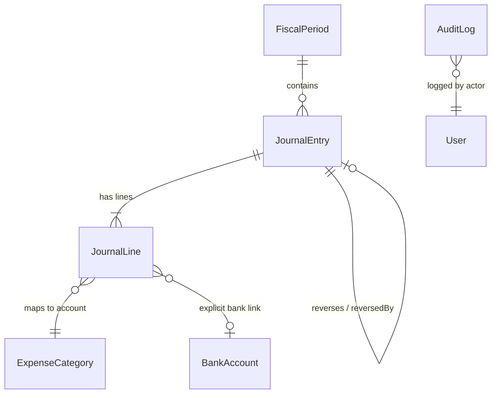

# FINLEDGER ERP — PERSISTENT GENERAL LEDGER & AUDIT ARCHITECTURE DESIGN

**Organization:** KVJ Analytics (Indian IT & Analytics Services)  
**System:** FinLedger ERP  
**Document Type:** General Ledger & Audit Trail Design  
**Baseline Date:** 21 October 2026  
**Document Status:** DESIGN FROZEN & EVIDENCE-BACKED (PROMPT 3)  

---

## 1. Executive Summary

This document specifies the database models, relationships, integrity constraints, idempotency mechanisms, and audit logging required to replace FinLedger's in-memory accounting engine with a **persistent, append-oriented, double-entry General Ledger**.

### Core Tenets
1. **Append-Only Immutability:** Once posted, a `JournalEntry` and its child `JournalLine` records are never updated or deleted. Corrections are effected exclusively through balanced **Reversal Entries** or **Adjustment Entries**.
2. **Canonical Account Mapping:** Reuses existing `ExpenseCategory`, `FinancialType`, `FinancialStatementGroup`, and `AccountNature` masters, linking real `BankAccount` IDs to avoid synthetic pseudo-accounts.
3. **Strict Balance Invariant:** A `JournalEntry` can only be committed if $\sum \text{Debit} \equiv \sum \text{Credit}$ down to the exact paisa (0.00 difference). No artificial rounding adjustments are introduced to force balance.
4. **Comprehensive Audit Compliance:** Meets Indian Companies Act, 2013 and MCA Audit Trail (Rule 11(g)) requirements through an immutable `AuditLog` collection capturing actor, action, timestamp, and before/after states.

---

## 2. General Ledger Data Models (Prisma Schema Design)



### 2.1 Model: `JournalEntry`
Represents an authoritative financial voucher containing two or more balanced lines.

```prisma
enum JournalEntryType {
  SALES
  PURCHASE
  RECEIPT
  PAYMENT
  CONTRA
  JOURNAL
  OPENING
  CLOSING
  REVERSAL
  ADJUSTMENT
}

enum PostingStatus {
  POSTED
  REVERSED
}

enum JournalSourceType {
  TAX_INVOICE
  INVOICE_PAYMENT
  EXPENSE
  EXPENSE_PAYMENT
  BANK_TRANSFER
  OPENING_BALANCE
  ASSET_DEPRECIATION
  ASSET_DISPOSAL
  LOAN_RECEIPT
  LOAN_REPAYMENT
  GST_SETTLEMENT
  TDS_DEPOSIT
  PERIOD_CLOSING
  MANUAL_ADJUSTMENT
}

model JournalEntry {
  id              String            @id @default(auto()) @map("_id") @db.ObjectId
  entryNumber     String            @unique // e.g., "JV-202627-0001", "SALES-202627-0001"
  entryType       JournalEntryType
  accountingDate  DateTime
  financialYear   String            // e.g., "2026-27"
  
  fiscalPeriodId  String?           @db.ObjectId
  fiscalPeriod    FiscalPeriod?     @relation(fields: [fiscalPeriodId], references: [id])

  sourceType      JournalSourceType
  sourceId        String            // ObjectId of source document (TaxInvoice, Expense, etc.)
  sourceNumber    String?           // Human-readable source reference (e.g. "KVJ/B2B/26-27/001")
  
  narration       String
  reference       String?           // External reference, bank UTR, challan number

  totalDebit      Float             // Validated at runtime: totalDebit === totalCredit
  totalCredit     Float
  isBalanced      Boolean           @default(true)
  status          PostingStatus     @default(POSTED)

  // Creation & Authorization Metadata
  postedAt        DateTime          @default(now())
  postedBy        String?           @db.ObjectId // User ID who triggered the posting
  authorizedBy    String?           @db.ObjectId // Admin who authorized or reviewed

  // Idempotency & Uniqueness
  idempotencyKey  String            @unique // e.g. "TAX_INVOICE:6789...:CONFIRM"

  // Reversal Tracking (Self-referential)
  reversalOfId    String?           @unique @db.ObjectId
  reversalOf      JournalEntry?     @relation("EntryReversal", fields: [reversalOfId], references: [id], onDelete: NoAction, onUpdate: NoAction)
  reversedBy      JournalEntry?     @relation("EntryReversal")
  reversalReason  String?
  reversedAt      DateTime?

  lines           JournalLine[]

  createdAt       DateTime          @default(now())
  updatedAt       DateTime          @updatedAt

  @@index([accountingDate])
  @@index([financialYear])
  @@index([sourceType, sourceId])
  @@index([status])
}
```

### 2.2 Model: `JournalLine`
Represents an individual debit or credit posting against a specific account in the Chart of Accounts.

```prisma
model JournalLine {
  id              String            @id @default(auto()) @map("_id") @db.ObjectId
  
  entryId         String            @db.ObjectId
  entry           JournalEntry      @relation(fields: [entryId], references: [id], onDelete: Cascade)
  
  lineNumber      Int               // 1-indexed line position within entry
  
  // Account Identity (Linking to Chart of Accounts)
  accountId       String            // Canonical identifier (e.g., ExpenseCategory.id or statutory account code)
  accountCode     String?           // Human-readable code e.g. "EXP-SAL-001", "AST-BANK-001"
  accountName     String            // Snapshot of account title for point-in-time audit integrity
  financialType   String            // ASSET, LIABILITY, EQUITY, INCOME, EXPENSE
  statementGroup  String            // "Revenue from Operations", "Trade Receivables", etc.
  normalBalance   String            // DEBIT, CREDIT

  // Monetary Posting (INR, Two Decimals)
  debit           Float             @default(0)
  credit          Float             @default(0)

  particulars     String?           // Line-level description / item narrative

  // Sub-Ledger Dimensions
  entityType      String?           // CUSTOMER, VENDOR, EMPLOYEE, BANK, LOAN, CATEGORY
  entityId        String?           // Target entity ObjectId (Customer.id, Vendor.id, etc.)
  
  // Real Bank Account Linking
  bankAccountId   String?           @db.ObjectId
  bankAccount     BankAccount?      @relation(fields: [bankAccountId], references: [id])

  createdAt       DateTime          @default(now())

  @@index([entryId])
  @@index([accountId])
  @@index([entityType, entityId])
  @@index([bankAccountId])
}
```

### 2.3 Model: `FiscalPeriod`
Defines accounting period boundaries and supports period-locking for statutory close.

```prisma
model FiscalPeriod {
  id              String            @id @default(auto()) @map("_id") @db.ObjectId
  financialYear   String            // e.g. "2026-27"
  periodName      String            // e.g. "April 2026", "Q1 2026-27", "FY 2026-27"
  periodCode      String            @unique // e.g. "2026-04", "FY-2026-27"
  startDate       DateTime
  endDate         DateTime
  isLocked        Boolean           @default(false)
  lockedAt        DateTime?
  lockedBy        String?           @db.ObjectId
  lockReason      String?

  entries         JournalEntry[]

  createdAt       DateTime          @default(now())
  updatedAt       DateTime          @updatedAt

  @@index([financialYear])
  @@index([isLocked])
}
```

### 2.4 Model: `AuditLog`
Indian Companies Act Rule 11(g) and MCA-compliant immutable audit trail tracking all modifications.

```prisma
model AuditLog {
  id              String            @id @default(auto()) @map("_id") @db.ObjectId
  actorId         String            @db.ObjectId // User ID
  actorName       String
  actorEmail      String
  action          String            // "POST_INVOICE", "CANCEL_INVOICE", "REVERSE_ENTRY", "MANUAL_ADJUSTMENT", "LOCK_PERIOD"
  entity          String            // "TaxInvoice", "JournalEntry", "Expense", "FiscalPeriod"
  entityId        String            // Target entity ID
  timestamp       DateTime          @default(now())
  ipAddress       String?
  userAgent       String?
  
  // State Delta
  beforeState     Json?
  afterState      Json?
  changeSummary   String?           // Concise explanation of change
  reason          String?           // User-supplied business justification

  @@index([entity, entityId])
  @@index([actorId])
  @@index([timestamp])
}
```

---

## 3. Account Hierarchy & Integration with Chart of Accounts

Existing Chart of Accounts masters (`FinancialType`, `FinancialStatementGroup`, `AccountNature`, `ExpenseCategory`) are fully leveraged.

### 3.1 Control Accounts vs Sub-Ledger Entities
Rather than creating disconnected account tables, `JournalLine` references canonical control accounts while tagging sub-ledger entities:

| Control Account Title | Financial Type | Statement Group | Normal Balance | Sub-Ledger Entity Tagged | Entity ID Reference |
|-----------------------|----------------|-----------------|----------------|--------------------------|---------------------|
| **Trade Receivables** | ASSET | Current Assets | DEBIT | `CUSTOMER` | `Customer.id` |
| **Trade Payables** | LIABILITY | Current Liabilities | CREDIT | `VENDOR` | `Vendor.id` |
| **Employee Payables** | LIABILITY | Current Liabilities | CREDIT | `EMPLOYEE` | `Employee.id` |
| **Bank Accounts** | ASSET | Cash & Cash Eq. | DEBIT | `BANK` | `BankAccount.id` |
| **Term Loans / Borrowings** | LIABILITY | Non-Current Liab. | CREDIT | `LOAN` | `Loan.id` |
| **Nominal Accounts (Sales, Travel, Rent)** | INCOME / EXPENSE | P&L Groups | CREDIT / DEBIT | `CATEGORY` | `ExpenseCategory.id` |
| **Statutory Tax Accounts (Output/Input GST, TDS)** | LIABILITY / ASSET | Statutory Taxes | CREDIT / DEBIT | None (System Master) | System Canonical IDs |

### 3.2 Bank Transfer Account Linking
- Currently, `BankTransfer` stores `fromAccount: string` and `toAccount: string`.
- In the new design, `BankTransfer` is upgraded to store foreign keys `fromBankAccountId` and `toBankAccountId` referencing `BankAccount.id`.
- The corresponding `JournalLine` entries explicitly populate `bankAccountId` and `entityId = BankAccount.id`, ensuring both accounts reconcile against real bank statements.

---

## 4. Correction & Reversal Mechanics (No Destructive Mutations)

### 4.1 Strict Rule: Historical Immutability
Under MCA guidelines and fundamental accounting principles:
- Once a `JournalEntry` has `status = "POSTED"`, its amounts, accounts, dates, and lines **CANNOT BE EDITED OR DELETED**.
- MongoDB Atlas document validation and service-layer middleware reject any direct `prisma.journalEntry.update` that attempts to alter financial fields (`totalDebit`, `totalCredit`, `lines`).

### 4.2 Document Cancellation Flow
When a source document is cancelled (e.g. `TaxInvoice` cancelled or `Expense` cancelled):
1. **Source Document Update:** `TaxInvoice.status` set to `CANCELLED`, `cancellationReason` recorded.
2. **Reversal Journal Voucher Generated:**
   - A new `JournalEntry` is created with `entryType = REVERSAL`.
   - The reversal lines are the exact inverse of the original entry (all original debits become credits; all original credits become debits).
   - `reversalOfId` links directly to the original entry ID.
   - `narration` explicitly cites the cancellation reason and original entry number.
3. **Original Entry Flagged:** Original entry updated to `status = REVERSED`, `reversedById` pointing to the reversal voucher.
4. **AuditLog Recorded:** An `AuditLog` entry records the actor, cancellation reason, and link between original and reversal vouchers.

### 4.3 Administrative Adjustments
When an authorized administrator makes a legitimate accounting adjustment:
1. Cannot edit existing entries.
2. An authorized user creates a `MANUAL_ADJUSTMENT` journal entry.
3. Mandatory fields required:
   - Specific debit and credit accounts.
   - Verified equilibrium ($\sum \text{Dr} = \sum \text{Cr}$).
   - Business justification narrative.
   - Super-Admin dual authorization ID.
4. An `AuditLog` entry is written with `action = "MANUAL_ADJUSTMENT"`.

---

## 5. Fiscal Periods & Period-Locking Rules

1. **Active Period:** New journal entries can be posted if `FiscalPeriod.isLocked === false`.
2. **Locked Period:** Once an accounting month or financial year has been closed and audited, an administrator locks the period (`isLocked = true`).
3. **Lock Enforcement:**
   - The posting service verifies `accountingDate` against `FiscalPeriod`. If locked, posting throws an `AccountPeriodLockedException`.
   - Reversals of transactions dating back to a locked period **cannot post to the locked date**; the reversal must be posted with the current open period's accounting date as a "Prior Period Correction".
4. **Emergency Unlock:** Requires Super-Admin permission, mandatory written justification, and creates an `AuditLog` record (`UNLOCK_PERIOD`).
