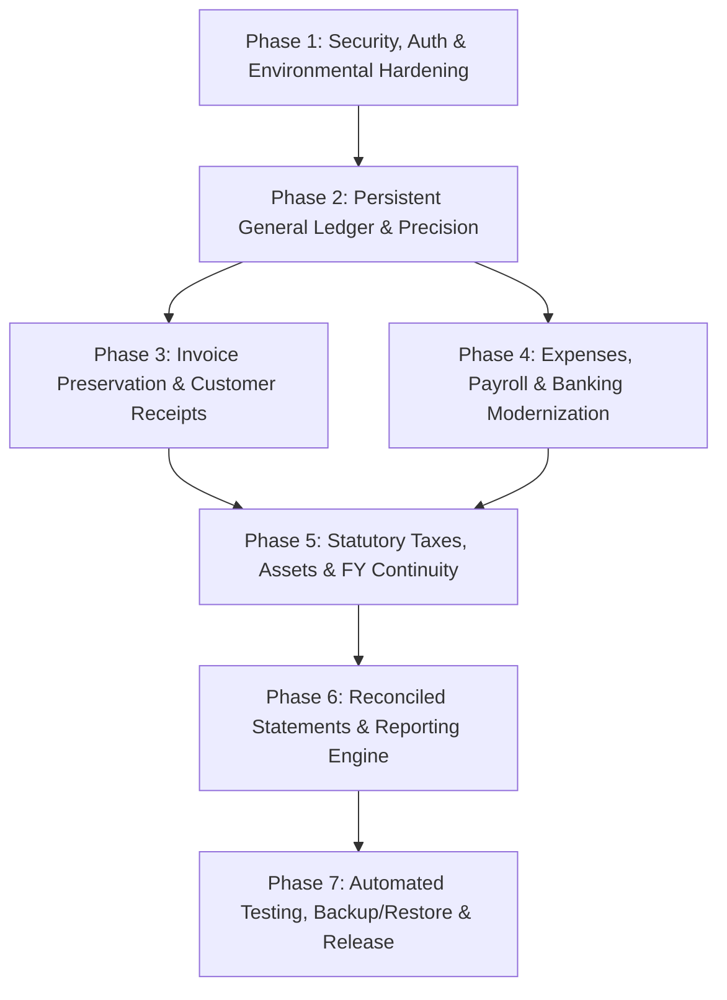

# FINLEDGER ERP — IMPLEMENTATION ROADMAP & VERIFICATION GATES

**Organization:** KVJ Analytics (Indian IT & Analytics Services)  
**System:** FinLedger ERP  
**Document Type:** Strategic Implementation Roadmap  
**Baseline Date:** 21 October 2026  
**Document Status:** PROPOSED & FROZEN  

---

## 1. Executive Implementation Strategy

The FinLedger implementation roadmap is structured into **seven sequential phases** designed to address confirmed vulnerabilities, establish data model immutability, enforce strict double-entry accounting, and provide enterprise-grade operational resilience without disrupting the approved invoice UI, layout, or calculations.

### Core Architecture Principles:
1. **Invoice UI & Layout Preservation:** All existing Proforma and Tax Invoice fields, templates, printable styles, and ribbon layouts remain immutable.
2. **Database Continuity:** MongoDB Atlas remains the production database platform; Prisma ORM remains the data access layer.
3. **Pure Accrual Double-Entry:** Every financial mutation writes balanced debits and credits to permanent General Ledger collections.
4. **Zero Downtime Migration:** Schema additions (`JournalEntry`, `JournalLine`, `AuditLog`) expand the schema without breaking existing document structures.

---

## 2. Phased Implementation Breakdown

### Phase 1: Security, Authentication & Environmental Hardening [COMPLETED — PROMPT 2]
- **Status:** **Completed & Verified in Prompt 2** (13/13 security test cases passed, build verified, committed).
- **Objective:** Eliminate critical security vulnerabilities, remove hardcoded secrets and backdoors, implement Edge middleware, and secure all Server Actions.
- **Key Tasks:**
  - `TASK-SEC-001`: Remove hardcoded fallback JWT secret; enforce `AUTH_SECRET` environment requirement.
  - `TASK-SEC-002`: Remove hardcoded backdoor credentials from `auth.ts`.
  - `TASK-SEC-003`: Create `middleware.ts` for NextAuth v5 route protection.
  - `TASK-SEC-004`: Add `requireAuth()` and role verification to all 17 unprotected Server Action files.
  - `TASK-SEC-005` & `TASK-SEC-006`: Decommission/secure `/api/test-db` and `/api/ledgers/statement`.
- **Verification Gate 1:**
  - Automated curl test: Unauthenticated requests to `/dashboard`, `/invoices`, and `/api/ledgers/statement` return 401 or redirect to `/login`.
  - Calling Server Actions without session throws unauthorized exception.
  - Database-only bcrypt authentication verified for all valid users.

---

### Phase 2: Data Model, General Ledger & Monetary Precision [DESIGN COMPLETED — PROMPT 3]
- **Status:** **Architecture & Migration Design Completed in Prompt 3** (Implementation Pending).
- **Objective:** Establish permanent double-entry collections (`JournalEntry` and `JournalLine`), implement MCA statutory audit logging, and standardize 2-decimal monetary precision.
- **Key Tasks:**
  - `TASK-GL-001`: Add `JournalEntry` and `JournalLine` models to `prisma/schema.prisma`.
  - `TASK-GL-002`: Add `AuditLog` model for Indian Companies Act compliance.
  - `TASK-GL-003`: Add `FiscalPeriod` model to support accounting period closing locks.
  - `TASK-GL-004`: Implement fixed 2-decimal rounding utility (`lib/utils/currency.ts`).
  - `TASK-GL-005`: Build atomic journal posting service (`services/journal-posting.service.ts`).
  - `TASK-GL-006`: Execute idempotent migration script backfilling existing transactions into permanent GL vouchers.
- **Verification Gate 2:**
  - Prisma generates client cleanly (`npx prisma generate`).
  - Backfilled journal vouchers achieve 100% balance equilibrium ($\sum \text{Dr} = \sum \text{Cr}$).
  - Audit trail records entity creations and updates with timestamp and user ID.

---

### Phase 3: Invoice Preservation & Customer Receipts Integrity
- **Objective:** Fix invoice numbering concurrency, add bank account selector to payment recording, implement submission idempotency, and handle customer advances cleanly.
- **Key Tasks:**
  - `TASK-INV-001`: Implement atomic sequential invoice numbering in `lib/invoice-number.ts`.
  - `TASK-INV-002`: Add `bankAccountId` relation to `InvoicePayment` and dropdown to Record Payment modal.
  - `TASK-INV-003`: Populate company details in invoice views dynamically from `CompanySettings`.
  - `TASK-INV-004`: Add client idempotency token to prevent duplicate payment submissions.
  - `TASK-INV-005`: Automatically reclassify excess customer receipts as Customer Advance liabilities.
- **Verification Gate 3:**
  - Concurrent invoice generation produces sequential numbers without collisions.
  - Payment records bind to selected bank accounts and update bank ledgers accurately.
  - Customer invoice printable view remains visually identical to approved design.

---

### Phase 4: Expenses, Payroll & Banking Modernization
- **Objective:** Fix inter-bank contra transfers, standardize accrual accounting for all expenses, ensure atomic payroll sequencing, and enhance bank reconciliation.
- **Key Tasks:**
  - `TASK-EXP-001`: Update `BankTransfer` to use `fromBankAccountId` and `toBankAccountId` foreign keys.
  - `TASK-EXP-002`: Ensure all expenses generate standard trade payable accruals before disbursement.
  - `TASK-EXP-003`: Pre-allocate expense numbers during batch payroll runs.
  - `TASK-EXP-004`: Automatically recover open employee advances during payroll runs.
  - `TASK-EXP-005`: Implement vendor advance utilization workflow.
  - `TASK-EXP-006`: Enhance bank statement reconciliation engine against persistent GL vouchers.
- **Verification Gate 4:**
  - Bank contra transfers update source and destination bank ledgers without synthetic accounts.
  - Batch payroll creates non-conflicting expense records and clears advance balances.
  - Bank statement reconciliation matches UTR/cheques accurately.

---

### Phase 5: Statutory Taxes, Fixed Assets & Multi-Year Continuity
- **Objective:** Consolidate GST settlement workflows, bind TDS challans to bank accounts, validate asset disposals, and roll forward prior-year retained earnings across financial year boundaries.
- **Key Tasks:**
  - `TASK-TAX-001`: Consolidate `GstFiling` and `GstSettlement` into a single authoritative service.
  - `TASK-TAX-002`: Bind `TdsDeposit` challans to specific bank accounts.
  - `TASK-TAX-003`: Validate fixed asset disposal gain/loss against accumulated depreciation.
  - `TASK-TAX-004`: Verify loan repayment splits (Principal liability reduction vs Finance cost expense).
  - `TASK-TAX-005`: Implement multi-year retained earnings roll-forward in Balance Sheet.
  - `TASK-TAX-006`: Build year-end fiscal period closing voucher generator.
- **Verification Gate 5:**
  - GST payment produces exactly one payment voucher with zero duplicate cash outflows.
  - Balance Sheet maintains mathematical equilibrium across multiple financial years.
  - Fixed asset register reconciles original cost, accumulated depreciation, and net book value.

---

### Phase 6: Reports, Financial Statements & Reconciliation Engine
- **Objective:** Transition financial reports to query indexed General Ledger collections directly, modularize `accounting-engine.service.ts`, and optimize Reports Hub performance.
- **Key Tasks:**
  - `TASK-RPT-001`: Refactor Trial Balance, P&L, Balance Sheet, and Cash Flow to query persistent `JournalLine` collections.
  - `TASK-RPT-002`: Modularize `accounting-engine.service.ts` into maintainable sub-services.
  - `TASK-RPT-003`: Optimize Reports Hub with on-demand tab loading.
  - `TASK-RPT-004`: Implement automated real-time trial balance equilibrium health check.
  - `TASK-RPT-005`: Build Form 24Q and Form 16 statutory TDS export generators.
- **Verification Gate 6:**
  - Reports load in < 500ms using indexed database queries; full-collection in-memory loading is eliminated.
  - Trial Balance difference remains exactly ₹0.00 across all date filters.
  - Exported Excel and statutory reports match ICAI Schedule III format.

---

### Phase 7: Automated Testing, Backup/Restore & Release Readiness
- **Objective:** Install Vitest and Playwright test suites, implement automated database restore tooling, add production safeguards to scripts, export the Excel test execution tracker, and certify release readiness.
- **Key Tasks:**
  - `TASK-TST-001`: Install and configure Vitest and Playwright with isolated test database.
  - `TASK-TST-002`: Implement comprehensive integration test suite covering all 30 business scenarios.
  - `TASK-TST-003`: Build and validate automated `scripts/restore-db.ts` restore tool.
  - `TASK-TST-004`: Add production environment guards to all data management scripts.
  - `TASK-TST-005`: Generate Excel Test Execution Tracker workbook (`FinLedger_Test_Execution_Tracker.xlsx`).
  - `TASK-TST-006`: Execute final pre-release quality and accounting verification audit.
- **Verification Gate 7:**
  - 100% test pass rate across unit, integration, and accounting verification tests.
  - Backup -> Wipe Test DB -> Restore -> Verify cycle succeeds with 100% record match.
  - Production certification report signed off.

---

## 3. Risk Management & Fallback Strategy

| Identified Risk | Probability | Severity | Mitigation & Rollback Strategy |
| :--- | :---: | :---: | :--- |
| **Breaking Invoice UI during Backend Updates** | Low | Critical | Field contracts, form models, and UI components are frozen. Backend services must maintain identical input/output interfaces. |
| **Data Inconsistency during Journal Backfill** | Low | High | Migration script runs in read-only dry-run mode first, validates balance equilibrium, and logs discrepancies before committing. |
| **Authentication Lockout after Backdoor Removal** | Low | Critical | Verify active bcrypt admin user in MongoDB before removing fallback credentials; test login in persistent session. |
| **Schema Migration Delays on MongoDB Atlas** | Low | Medium | Additive schema changes (new collections) do not lock existing collections or require downtime. |
