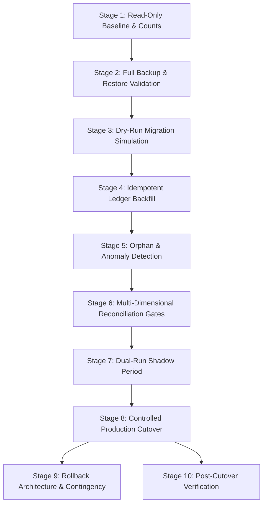

# FINLEDGER ERP — LEGACY MIGRATION & RECONCILIATION PLAN

**Organization:** KVJ Analytics (Indian IT & Analytics Services)  
**System:** FinLedger ERP  
**Document Type:** Phased Migration, Data Reconciliation & Rollback Design  
**Baseline Date:** 21 October 2026  
**Document Status:** DESIGN FROZEN & EVIDENCE-BACKED (PROMPT 3)  

---

## 1. Executive Migration Strategy

FinLedger currently relies on an in-memory accounting engine that dynamically calculates financial statements across 14 MongoDB collections. To transition safely to a **persistent, immutable double-entry General Ledger** without data loss, downtime, or mathematical distortion, we have designed a **10-stage phased migration framework**.



### Non-Negotiable Tenets
1. **Zero Data Loss:** Existing financial records (`TaxInvoice`, `Expense`, `InvoicePayment`, etc.) are never mutated, overwritten, or reseeded.
2. **Deterministic Idempotency:** Every migrated voucher receives a deterministic idempotency key. Rerunning the migration script will never produce duplicate entries.
3. **No Artificial Balancing Adjustments:** If historical data contains unbalanced entries, they are logged into an audit report and mapped to an explicit `Opening / Migration Suspense` account. They are never silently altered.
4. **DESIGN ONLY:** This plan specifies the execution architecture. No migration script will be executed in this prompt.

---

## 2. The 10-Stage Migration Framework

### Stage 1: Read-Only Baseline & Source-Record Inventory
Before initiating any backfill, a read-only script gathers exact baseline metrics from MongoDB Atlas:

```typescript
// Read-only baseline metrics query
const baseline = {
  taxInvoices: await prisma.taxInvoice.count(),
  taxInvoicesConfirmed: await prisma.taxInvoice.count({ where: { status: { in: ["CONFIRMED", "PAID", "PARTIALLY_PAID"] } } }),
  invoicePayments: await prisma.invoicePayment.count({ where: { OR: [{ isCancelled: false }, { isCancelled: null }] } }),
  expenses: await prisma.expense.count(),
  expensesApproved: await prisma.expense.count({ where: { status: "APPROVED" } }),
  expensePayments: await prisma.expensePayment.count({ where: { OR: [{ isCancelled: false }, { isCancelled: null }] } }),
  bankTransfers: await prisma.bankTransfer.count(),
  openingBalances: await prisma.openingBalance.count(),
  gstFilings: await prisma.gstFiling.count(),
  gstSettlements: await prisma.gstSettlement.count(),
  tdsDeposits: await prisma.tdsDeposit.count(),
  assetDepreciations: await prisma.assetDepreciation.count(),
  assetDisposals: await prisma.assetDisposal.count(),
  loans: await prisma.loan.count(),
  loanRepayments: await prisma.loanRepayment.count(),
};
```
- **Sum Verification:** Aggregate sums for gross turnover, taxable amounts, CGST, SGST, IGST, TDS, and bank disbursements are calculated and frozen in a baseline manifest file (`prisma/backup/baseline_manifest.json`).

---

### Stage 2: Full Backup & Restore Validation Prerequisite
1. **Database Export:** Run `scripts/backup-db.ts` to export all collections into an offline, timestamped JSON snapshot (`prisma/backup/db_snapshot_pre_migration_{timestamp}.json`).
2. **MongoDB Atlas Native Snapshot:** Trigger an on-demand cluster snapshot via the MongoDB Atlas Cloud Console or Management API.
3. **Restore Test Prerequisite:** Validate restore feasibility by restoring the JSON backup to a local test MongoDB instance or staging cluster, verifying that record counts match 100%.

---

### Stage 3: Dry-Run Migration Simulation (`--dry-run`)
A dedicated migration runner `scripts/migrate-ledger.ts` is executed with `--dry-run`:
- Reconstructs every journal voucher in memory.
- Validates that every voucher satisfies $\sum \text{Debit} \equiv \sum \text{Credit}$.
- Verifies that all account IDs resolve to valid Chart of Accounts or Bank Account entities.
- Generates a **Dry-Run Audit Report** highlighting:
  - Total proposed `JournalEntry` count.
  - Total proposed `JournalLine` count.
  - Any voucher failing balance validation.
  - Zero writes are committed to the database.

---

### Stage 4: Deterministic Idempotent Ledger Backfill
The backfill script executes chronologically through existing accounting records using stable idempotency keys:

| Transaction Domain | Idempotency Key Format | Backfill Logic |
|--------------------|------------------------|----------------|
| **Opening Balances** | `MIGRATE:OB:{financialYear}` | Grouped by FY; maps debit and credit positions |
| **Fixed Assets** | `MIGRATE:ASSET:{expense.id}` | Capital asset acquisition entries |
| **Tax Invoices** | `MIGRATE:INV:{invoice.id}` | Backfilled for `CONFIRMED`, `PAID`, `PARTIALLY_PAID` |
| **Invoice Payments** | `MIGRATE:RCPT:{payment.id}` | Bank receipts and TDS deductions |
| **Expenses (Accrual)** | `MIGRATE:EXP:{expense.id}` | Approved vendor and operational bills |
| **Expense Payments** | `MIGRATE:EXPPAY:{payment.id}` | Direct disbursements and reimbursements |
| **Bank Transfers** | `MIGRATE:TRF:{transfer.id}` | Inter-bank contra vouchers |
| **Depreciation** | `MIGRATE:DEP:{depreciation.id}` | Periodic asset depreciation write-offs |
| **GST Settlements** | `MIGRATE:GST:{settlement.id}` | Output tax offsets and cash challans |
| **TDS Deposits** | `MIGRATE:TDS:{deposit.id}` | Statutory government tax payments |
| **Loans & Repayments** | `MIGRATE:LOAN:{id}`, `MIGRATE:REPAY:{id}` | Loan receipts and principal/interest amortization |

Each batch runs inside a MongoDB multi-document transaction (`prisma.$transaction`). If a key already exists, `upsert` or skip ensures re-run safety.

---

### Stage 5: Anomaly, Orphan & Discrepancy Detection
During backfill, the migration engine detects and flags four categories of legacy anomalies:
1. **Orphaned Payments:** `InvoicePayment` referencing a deleted or non-existent `taxInvoiceId`.
2. **Unbalanced Historical Invoices:** Tax Invoices where line items sum does not equal header gross amount due to legacy manual edits.
3. **Mismatched Statuses:** Invoices marked `PAID` where sum of payments is less than gross amount.
4. **Unbalanced Opening Balances:** Opening balance entries where total asset debits do not equal total liability/equity credits.

**Handling Policy:**
- Anomalies are never discarded.
- Unbalanced differences are allocated to `acc_migration_suspense` ("Legacy Migration Suspense Account - Equity").
- An **Anomaly Log Document** (`docs/planning/MIGRATION_ANOMALIES_REGISTER.md`) is populated with the document ID, amount, and recommended resolution requiring CA review.

---

### Stage 6: Multi-Dimensional Reconciliation Gates

Before cutover can proceed, the persistent ledger must pass **7 strict reconciliation gates**:

```
[GATE 1] Trial Balance Equilibrium:  Total Debit === Total Credit (Diff = 0.00)
[GATE 2] Revenue Reconciliation:     GL Revenue === Sum of Tax Invoice Taxable Amounts
[GATE 3] Output GST Reconciliation:  GL Output CGST/SGST/IGST === Tax Invoice GST Totals
[GATE 4] Customer Sub-Ledgers:       GL Customer Balances === Invoice Outstanding Balances
[GATE 5] Vendor Sub-Ledgers:         GL Vendor Balances === Expense Balance Payable Totals
[GATE 6] Bank Account Ledgers:       GL Bank Balances === Calculated Bank Statement Positions
[GATE 7] Statutory TDS Balances:     GL TDS Receivable/Payable === Recorded TDS Schedules
```

*Pass Criteria:* Every gate must report zero variance, or any variance must be accounted for in the approved Anomaly Register.

---

### Stage 7: Dual-Run Shadow Period
To ensure 100% operational continuity:
1. New transactions continue to update operational documents.
2. The new atomic posting service simultaneously writes persistent `JournalEntry` and `JournalLine` records.
3. A daily verification job compares financial reports generated from:
   - Method A: Legacy `accounting-engine.service.ts`
   - Method B: New persistent `services/ledger.service.ts`
4. The system remains in shadow mode until 100% concordance is observed over multiple transaction cycles.

---

### Stage 8: Controlled Production Cutover
1. **Maintenance Window:** Announce a 30-minute read-only window during off-peak hours.
2. **Execute Final Delta Migration:** Backfill any transactions created during the shadow period.
3. **Verify Reconciliation Gates:** Confirm all 7 gates pass.
4. **Switch Reporting Services:** Update `services/ledger.service.ts`, `trial-balance.service.ts`, `profit-loss.service.ts`, and `balance-sheet.service.ts` to query `prisma.journalEntry` and `prisma.journalLine` directly.
5. **Decommission In-Memory Engine:** Remove dynamic 14-collection querying from `accounting-engine.service.ts`.

---

### Stage 9: Rollback Architecture & Contingency Plan

If critical defects or report discrepancies arise during cutover:
1. **Instant Application Rollback:** Revert reporting services to point back to `accounting-engine.service.ts` via an environment flag:
   ```bash
   USE_PERSISTENT_LEDGER=false
   ```
2. **Database Cleanliness Guarantee:**
   - Because legacy operational models (`TaxInvoice`, `Expense`, etc.) were never mutated, operational workflows remain 100% intact.
   - If persistent ledger records must be purged, run:
     ```typescript
     await prisma.journalLine.deleteMany({});
     await prisma.journalEntry.deleteMany({});
     ```
3. **Worst-Case Restore:** Restore MongoDB Atlas snapshot taken in Stage 2.

---

### Stage 10: Post-Cutover Verification
1. Verify that creating a new Tax Invoice, recording a payment, and approving an expense writes persistent `JournalEntry` records.
2. Verify that Trial Balance, Balance Sheet, and P&L render in sub-100ms (compared to 1500ms+ under the legacy in-memory engine).
3. Confirm that all customer invoice printable layouts and figures remain identical to approved baselines.
